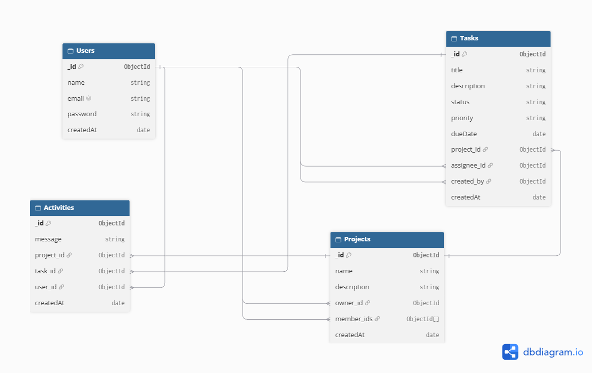

# TaskMatrix

A project management app for small software teams, kind of like a mini Jira/Asana. Teams can make projects, add tasks to a Kanban board, drag tasks between columns, assign them to people, and see a live feed of what's changing.

**Repo name:** prodesk-capstone-taskmatrix

---

## Designated Track

**Fullstack**

---

## Tech Stack

| Part | Tech |
| --- | --- |
| Frontend | React (Vite), React Router |
| Styling | Tailwind CSS |
| Drag and drop | @hello-pangea/dnd |
| Backend | Node.js + Express |
| Database | MongoDB Atlas + Mongoose |
| Auth | JWT (login/signup) + bcrypt for passwords |
| Real-time | Socket.io (activity feed) |
| Deployment | Vercel (frontend), Render (backend) |

---

## Problem

Small teams lose track of who is doing what. TaskMatrix gives them one board where every task has an owner, a priority and a deadline, and everyone sees updates live.

---

## Core Features (Prioritized)

### P0 - Must have
1. Sign up / log in / log out with JWT
2. Create, edit and delete projects
3. Kanban board with 3 columns: To Do, In Progress, Done
4. Create, edit and delete tasks (title, description, priority, due date)
5. Drag and drop tasks between columns (status saves to the database)

### P1 - Should have
6. Assign a task to a team member
7. Priority tags (Low / Medium / High) with colors
8. Roles: Admin and Member (only Admin can delete a project or add members)
9. Add members to a project
10. Real-time activity feed with Socket.io (e.g. "Riya moved Login Page to Done")

### P2 - Nice to have
11. AI helper: suggest subtasks or summarize project progress
12. Overdue task highlighting
13. Deadline reminders

### Out of scope (to avoid scope creep)
- Video calls, chat, payments, file uploads, mobile app

---

## User Roles

- **Admin:** creates the project, adds/removes members, can delete the project and any task
- **Member:** can create tasks, edit tasks, move tasks, see the activity feed

---

## Main Screens

1. Auth screen (login / signup)
2. Dashboard (list of my projects)
3. Project board (Kanban)
4. Task details (side panel or modal)

All screens have a mobile layout too.

---

## UI/UX Wireframes

Figma link: https://www.figma.com/design/9TU4pEOna7J9HgVAozkdnI/TaskMatrix-Wireframes?node-id=0-1&t=XS1KCD1nn8T0rDJD-1

---

## Architecture (ERD)

Collections: Users, Projects, Tasks, Activities

- A user can own many projects and be a member of many projects
- A project has many tasks
- A task is assigned to one user
- Every action creates an activity, which feeds the activity feed

---

## Live Links

- Frontend (Vercel): https://prodesk-capstone-taskmatrix-phi.vercel.app/
- Backend (Render): https://taskmatrix-api.onrender.com/
- GitHub: https://github.com/Mahiiv/prodesk-capstone-taskmatrix

Note: the backend is on Render's free tier, so it sleeps when nobody uses it. The first request (register or login) can take around 50 seconds to wake it up.

---

## Sprint 14 Progress (MVP / Walking Skeleton)

This sprint was only about authentication and routing. The app is unstyled on purpose, the goal was to get the whole pipeline working end to end.

Done (Track B, Phase 1 and Phase 2):
- User schema in Mongoose (name, email, password)
- Passwords are salted and hashed with bcryptjs before saving (checked in MongoDB Atlas, the password is a `$2a$10$...` string, not plain text)
- `POST /api/auth/register` and `POST /api/auth/login` that return a JWT (expires in 1 day)
- React Register and Login forms with working input handling
- JWT and user saved in localStorage, then redirect to the Dashboard
- Dashboard shows the logged in user's name and email, with a Logout button
- Backend deployed on Render, frontend deployed on Vercel

Not done yet (Phase 3, skipped this sprint):
- Auth middleware that protects the data endpoints
- Redirecting to /login when the token is missing or expired (so /dashboard can still be opened by typing the URL)

---

## API Endpoints

| Method | Route | What it does |
| --- | --- | --- |
| POST | /api/auth/register | Makes a new user (name, email, password) and returns a token |
| POST | /api/auth/login | Checks email and password and returns a token |

---

## Run Locally

Backend:
1. `cd server`
2. `npm install`
3. Make a `.env` file with `MONGO_URI`, `JWT_SECRET` and `PORT=5000`
4. `node server.js`

Frontend:
1. `cd client`
2. `npm install`
3. Make a `.env` file with `VITE_API_URL=http://localhost:5000`
4. `npm run dev`

---

## Other Files

- `server/` - Express backend (models, routes, server.js)
- `client/` - React (Vite) frontend
- `Prompts.md` - AI prompts I used (planning and Sprint 14)
- `erd.png` - database diagram
